# Phase 5 — Real mesh and docs

## #14 Bunny hole filling

**Theory → code.** The book names hole filling as an application of fairing: smooth patches fill holes (§4.3, Fig. 4.7 right), computed with the thin-plate equation **Δ²x = 0** (p. 61, which points to Ch. 8). With k = 2, fixing two rings of vertices around the region gives approximately C¹ continuity at its border (p. 60, #11). Nothing new is needed in the solver: `solve_fair(V, F, free, 2, laplacian)`.

**Data.** The Stanford Bunny, from the Stanford 3D Scanning Repository (credit: Stanford Computer Graphics Laboratory). The repository allows research use and free redistribution with credit, but not commercial use. The mesh is downloaded into the git-ignored `data/` folder (README, "The Stanford bunny") and never committed. We use the decimated reconstruction `bun_zipper_res2.ply`: 8146 used vertices, 16301 triangles.

| Step | Code |
|---|---|
| read a PLY into plain V, F (drop unused vertices) | `load_mesh`, `fairing/mesh.py:234` |
| find non-manifold and boundary edges | `edge_face_counts`, `fairing/mesh.py:290` |
| damage by flattening onto the border's plane | `flatten_onto_border_plane`, `fairing/mesh.py:346` |
| region, damages, refills, figure | `examples/05_bunny.py` |

**Choosing the region: the mesh has problems.** The archive's README warns that the decimated versions were made with a crude algorithm that may not preserve the mesh's topology. Indeed, `bun_zipper_res2` has 342 vertices on problem edges: *non-manifold* edges, shared by more than two triangles, where one-rings and cotangent weights are not defined as in the book, and boundary edges (holes at the bottom). The full-resolution mesh is manifold, but much denser. Since the free vertices' equations reach only k rings beyond the region plus the triangles around them (#9), the region only has to stay **at least k + 1 = 3 rings** away from the problem edges. The example picks the vertex farthest from them (11 rings away) and frees its **6-ring**: 158 vertices, about 3 cm across on a 15 cm bunny, at least 5 rings from any problem edge, on the bunny's side near the front leg. A test checks this clearance when the bunny is present.

**Damage, two kinds** (mean edge length 0.0030):
- *noise:* Gaussian noise with σ = half an edge on the free vertices;
- *flatten:* the free vertices projected onto the least-squares plane of the region's border (its first fixed ring), a crude patch.

**Refill:** k = 2 with **cotangent weights frozen from the damaged input** (the book's linear method) and with **uniform weights**.

| refill (k = 2) | max distance to the original | mean \|H\| on the region |
|---|---|---|
| (original, for reference) | — | 44 |
| uniform, from the noisy start | 0.0028 | 21 |
| uniform, from the flattened start | 0.0028 (identical: difference exactly 0) | 21 |
| cotangent, from the noisy start | 0.0037 | **81** |
| cotangent, from the flattened start | **0.0012** | **15** |

The two cotangent refills differ by up to 0.0038, more than an edge.

What this shows, with #10–#12 behind it:
- **Uniform weights ignore the start.** The free vertices' starting positions enter `solve_fair` only through the weights, so both damages give exactly the same uniform refill.
- **Cotangent weights inherit the start.** From the noisy start, the weights are frozen from a crumpled surface (noise of half an edge), and the refill is rough: mean |H| 81, worse than the original. From the flattened start, a clean surface, it is the smoothest refill and the closest to the original.
- **A thin plate is smooth by design.** All good refills have a lower mean curvature than the original (15–21 vs 44): the original has scan detail, and the thin plate replaces it with the smoothest surface that fits the border. Refilling does not "restore" lost detail.

Tests (`tests/test_fairing.py`, `tests/test_mesh.py`). A sphere stands in for the bunny, so CI does not need the download:
- the uniform refill is identical from a noisy and from a flattened start;
- the cotangent refills differ, and the one from the flattened start is closer to the sphere;
- `edge_face_counts` detects boundary and non-manifold edges, `load_mesh` drops unused vertices, and `flatten_onto_border_plane` makes the free vertices coplanar without moving the fixed ones;
- the bunny region's clearance from problem edges, run only when the bunny is downloaded.
- the Fig. 4.7-like region (below) is a disk at least k + 1 rings from the full-resolution bunny's boundary edges, run only when the bunny is downloaded.
- the upper-back region (below) is too, under the same condition;
- so is the second real hole's region (below), under the same condition;
- hole filling (below), on a sphere with a cap cut out: the patch is built without the removed positions (setting them to NaN changes nothing), it closes the hole without gaps or seams and with the original topology, the fixed vertices stay put, and the free rows' residual vanishes. Skipped without the `hole` extra.

**What the figures show.**

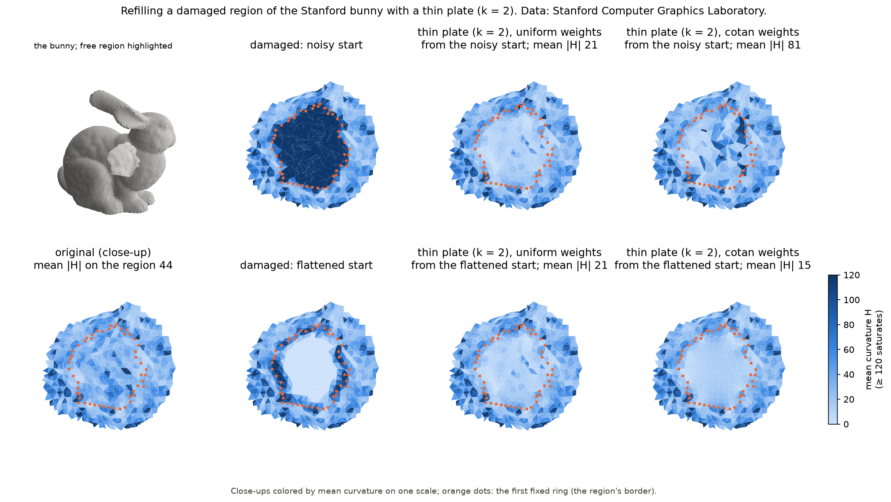

`docs/img/14-bunny-before-after.png`. Top left: the bunny, with the region highlighted. The other panels are close-ups colored by mean curvature on one scale; orange dots mark the region's border (the first fixed ring).
- Bottom left, the original: scan detail everywhere (mean |H| 44).
- Second column, the damaged inputs: noise (dark, very high curvature) and the flattened patch (pale inside, with dark creases where it meets the border).
- Third column, uniform refills: identical in both rows, smooth.
- Fourth column, cotangent refills: rough with dark spikes from the noisy start (81), the smoothest from the flattened start (15).

To explore it in 3D:
- `examples/05_polyscope_bunny_explorer.py` is an **interactive explorer**. One bunny, with the camera on the region, and a panel to change the region's size (rings), the damage (none, noise with its level, flatten), the order k (1, 2, 3) and the weights (uniform, cotangent). Each change re-solves at once. The panel shows the clearance from problem edges (with a warning when the region gets too close), the mean |H| of the original, the start and the result, and the distance to the original. A transparent ghost of the original can be overlaid.
- `examples/05_polyscope_bunny.py` shows the original, the damaged inputs and all four refills side by side.
- The README has a short snippet.

### A hole like the book's (Fig. 4.7)

The region above is small (a 6-ring, 158 vertices) because the decimated bunny has no room for more. The book's Fig. 4.7 (right) shows a much larger hole on the haunch, filled with a smooth patch. To compare with it, `examples/05_bunny_book_region.py` frees a similar region on the **full-resolution** `bun_zipper.ply`, from the same download: 34834 used vertices, 69451 triangles, mean edge 0.0015. On the decimated mesh, the same region would contain 7 non-manifold edges and would not be a disk. The full mesh has no non-manifold edges, and its boundary edges (the holes in its base) are at least 21 rings from the region.

**What the book gives, and what we chose.** The figure's caption says only that fairing fills holes with smooth patches, and p. 61 points to the thin-plate equation Δ²x = 0 for hole filling (Ch. 8). The book does not give the hole's exact position, the weights, or how the hole is initialized, so:
- *Region* (`book_region`): the vertices within a distance 0.035 of a haunch vertex (the one closest to a point picked by eye from the figure), keeping the connected piece that contains it. That gives 2660 vertices, forming a disk (Euler characteristic 1).
- *Camera:* matplotlib's `view_init(15, -60)`, matched by eye to the figure (head left, haunch right).
- *Damage and refill:* as above, noise (σ = half an edge) or flattening, then k = 2 with uniform or cotangent weights.
- *Our hole keeps its triangles.* We discard the free vertices' positions but keep the original connectivity. A real hole has no vertices inside, so filling it first needs a triangulation of the hole, which is the topic of Ch. 8. Here we test only the fairing step; the last subsection below builds a new triangulation for a real hole.

| refill (k = 2) | max distance to the original | mean \|H\| on the region |
|---|---|---|
| (original, for reference) | — | 63 |
| uniform, from the noisy start | 0.0040 | 23 |
| uniform, from the flattened start | 0.0040 (identical: difference exactly 0) | 23 |
| cotangent, from the noisy start | 0.0035 | **46** |
| cotangent, from the flattened start | 0.0039 | **18** |

The two cotangent refills differ by up to 0.0045 (3 edges). The original's 63 cannot be compared with the 44 of the small region: the haunch is bumpier (62 there on the decimated mesh too), and curvature values also change with the mesh's resolution.

What the comparison shows:
- **The same picture as the book.** From the flattened start, both refills are smooth patches that blend into the haunch, like the book's right image. The scan bumps inside the hole are gone: as above, a thin plate does not restore lost detail.
- **The conclusions of the small region hold at this size.** Uniform weights ignore the start (difference exactly 0). Cotangent weights inherit it: the refill is rougher from the noisy start (46, with a few dark specks) and the smoothest from the flattened start (18).
- **The distance to the original no longer separates the refills.** All are 0.0035–0.0040 from the original (2–3 edges). On a hole this large, that distance comes from the thin plate replacing the haunch's own shape, not from the weights.

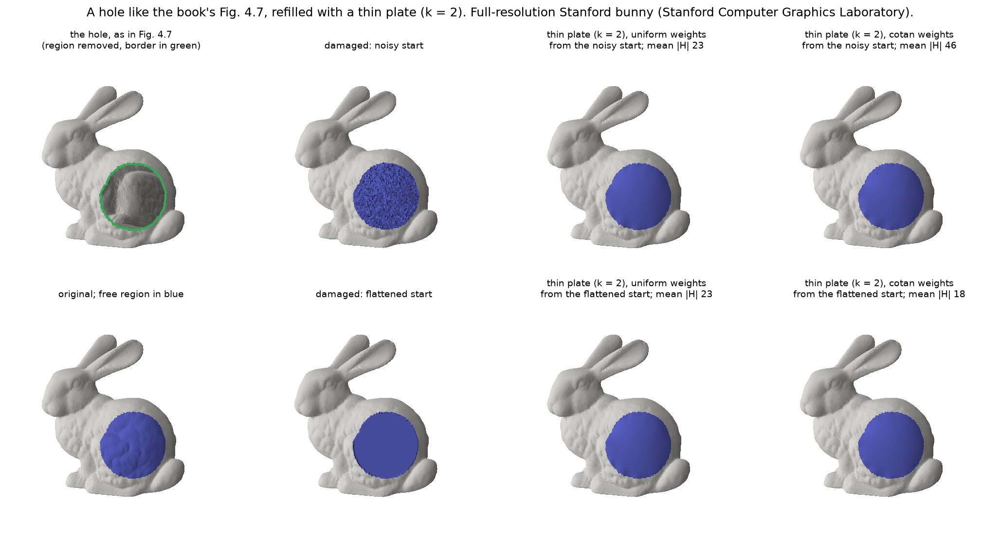

`docs/img/14-bunny-book-region.png`, laid out like the first figure, but every panel shows the whole bunny at the book's angle, lit, with the free region in blue (no curvature colors).
- Top left, the hole as in Fig. 4.7: the region's triangles removed and its border in green. The inside of the bunny shows through.
- Bottom left, the original, with the free region in blue.
- Second column, the damaged inputs (noise on top, flattened below).
- Third and fourth columns, the uniform and cotangent refills from each start. The dark specks of the cotangent refill from the noisy start are visible top right.

`examples/05_polyscope_bunny_book.py` opens the same bunny in polyscope, from the book's angle. By default it shows the refill in plain gray with the green border, as in the book. A panel switches between the hole, the damaged input, the refill and the original; changes the radius (0.015–0.045, always a disk), the damage, the order k and the weights; and colors by the free region or by mean curvature.

### A hole on the upper back, outlined by hand

The book-like hole sits on the side of the haunch, facing the camera. `examples/05_bunny_back_region.py` frees a region that was outlined by hand on a picture of the bunny, seen from about the same angle: the top of the haunch, from the middle of the back to the rear silhouette. It is larger than the book-like hole, and it wraps over the back.

**From an outline to vertices.** A drawing is 2D, but the solver needs a set of vertices. We first matched the picture's silhouette to the mesh's, seen orthographically from matplotlib's `view_init(16, -62)`; the two silhouettes overlap with an IoU of 0.89. We then collected the vertices that are visible inside the outline and searched for the ball (a center on the surface and a radius) that covers them best. This matching was a one-off step, done outside the repository: the script stores only its result, a center near (0.027, −0.011, 0.123) and a radius of 0.04, which covers 89% of the outlined vertices seen from that angle. `book_region` builds the region from them, as above: 3418 vertices, a disk, at least 41 rings from the boundary edges. Being a ball, the region also continues a little past the silhouette, onto the part of the back that the picture cannot show.

| refill (k = 2) | max distance to the original | mean offset along the normal | mean \|H\| on the region |
|---|---|---|---|
| (original, for reference) | — | — | 44 |
| uniform, from the noisy start | 0.0071 | −0.0014 | 28 |
| uniform, from the flattened start | 0.0071 (identical: difference exactly 0) | −0.0014 | 28 |
| cotangent, from the noisy start | 0.0067 | −0.0016 | **55** |
| cotangent, from the flattened start | 0.0069 | **−0.0026** | **27** |

The offset is measured along the original's vertex normals; a negative value means the patch lies below the original surface. The two cotangent refills differ by up to 0.0078 (5 edges).

What this region adds:
- **A thin plate flattens a dome.** This region is a cap: the back curves down on every side of it. Every refill lies below the original on average, by 1–2 edges, and the largest displacement reaches about 5 edges (0.0067–0.0071), almost twice that of the book-like hole. The reason is that Δ²x = 0 does not reproduce a sphere. On a sphere, Δx = −2Hn, and the normal n changes from point to point, so Δ²x ≠ 0. A thin plate therefore pulls a curved cap toward a flatter surface, and the effect grows with the hole's size and curvature.
- **The conclusions about the weights still hold.** Uniform weights ignore the start (difference exactly 0). Cotangent weights inherit it: the refill is rough from the noisy start (55, above the original's 44) and the smoothest from the flattened start (27). That smoothest refill also sinks the deepest (−0.0026, almost twice the uniform −0.0014), and its weights come from the flat lid, not from the dome.

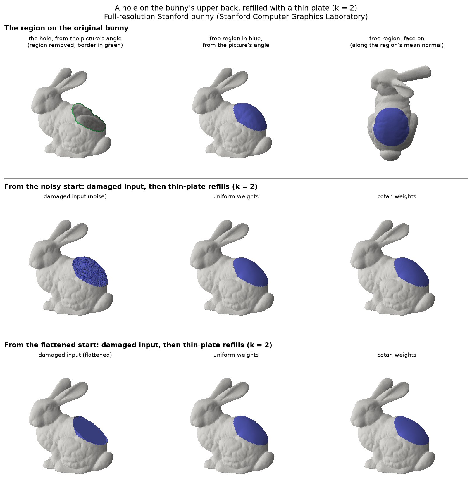

`docs/img/14-bunny-back-region.png`, in three groups of three panels. All panels use the picture's angle (16, −62), except the top right one, which looks along the region's mean normal (55, 1), because the picture's angle sees the region at a grazing angle.
- The first group, set apart by a line, shows only the original bunny. It shows the hole (the region's triangles removed, with the ring of faces around it in green, so the inside of the bunny shows through), the free region in blue, and the same region face on, with its scan bumps.
- Each of the other two groups is one start, laid out the same way: damaged input, uniform refill, cotangent refill. The first is the noisy start; the second is the flattened start, a flat lid that cuts below the back's curve.

### A real hole: build a patch, then fair it

All the regions above keep their triangles: the damage replaces the free vertices' positions, but the original connectivity stays. `examples/05_bunny_hole_filling.py` makes a **real hole** in the upper-back region and fills it in two separate steps. Patch construction supplies the triangulation; fairing computes a smooth shape for its interior.

**1. Cut the hole.** Every face with a free vertex is removed, and so are the 3418 free vertices themselves (7032 triangles in all). The surviving mesh has 31416 vertices and 62419 triangles. Its new boundary loop has 198 vertices, exactly the region's first fixed ring. The bunny's 5 other boundary loops (the holes in its base) are unchanged. The script checks all three facts, and it keeps an untouched copy of the bunny for the figures and the evaluation only.

**2. Build a replacement patch from the boundary alone.** The book leaves this step to Ch. 8, so the method is ours, kept deliberately simple:
- *Fit a plane* to the loop's 198 vertices (least squares through their centroid), with its normal on the side of the surviving faces. The loop is not planar: it lies up to 0.0058 (4.5 edges) from the plane, 1.4 edges on average.
- *Project the loop* into the plane's 2D coordinates and check that it is a simple polygon: no repeated vertex, no two non-adjacent edges that touch or cross, nonzero area.
- *Triangulate the polygon* with a constrained Delaunay triangulation, using Shewchuk's Triangle through the `triangle` package (the optional `hole` extra: `pip install -e ".[hole]"`). The loop's edges are segments; `Y` forbids new vertices on them, so the loop's vertices and edges are kept as they are; `q30` asks for angles of at least 30°; and `a` caps each triangle's area at that of an equilateral triangle whose side is the loop's mean edge length, h = 0.00131. The sampling density therefore comes from the surviving boundary, not from the removed interior.
- *Initialize* the 4064 new interior vertices on the fitted plane. The loop's corners are the surviving mesh's own vertices, so they keep their exact 3D positions and are not duplicated. The boundary is not planar, so this is an approximately planar interior initialization, with the original 3D boundary preserved.
- *Attach* the 8324 new triangles, oriented against the hole's boundary half-edges, so the orientation stays consistent.

The removed interior positions and triangles are never read: the script sets the removed positions to NaN, rebuilds the hole, the patch and both fairings, and gets bit-identical arrays.

**3. Fair the interior.** Only the 4064 new vertices are free; the surviving bunny, including the loop and the rings around it, stays fixed. Both solves use the same initialized mesh, connectivity and free mask: `solve_fair(V_init, F_new, free_new, 2, laplacian=...)`, with uniform or cotangent weights frozen from `V_init`, the planar patch and the surviving mesh around it. No reference geometry is taken from the original bunny.

**Checks** (printed by the script):

| Check | Result |
|---|---|
| the filled mesh | 35480 vertices, 70743 triangles, the same Euler characteristic as the original (−3) |
| the patch uses the loop's vertices and no other surviving vertex | yes; the nearest new vertex is 0.65 h from the loop |
| gaps, seams, non-manifold edges | none: the only open edges are the bunny's own 223 |
| orientation | consistent: no half-edge appears twice |
| initial triangles | coordinates finite; smallest area 0.34 of an equilateral triangle of side h; smallest angle 7.8°, in triangles that touch the loop, where it rises out of the plane; inside the patch, every angle is at least 30° |
| fixed vertices after fairing | bit-identical to the input, for both weightings |
| relative residual of the free rows, with the matrix `fairing_matrix(V_init, F_new, 2, ...)` that the solve froze | 4.4 × 10⁻¹⁵ (uniform), 8.5 × 10⁻¹⁵ (cotangent) |

**Comparison with the original.** The patch has a different number of vertices than the removed region and no vertex correspondence, so we do not compare coordinates. We measure surface distances instead: from the vertices and face centroids of the patch to the original removed triangles (exact point-to-triangle distances), and back.

| patch (k = 2) | mean distance to the original | max distance (either way) | mean signed offset | mean \|H\| on the patch |
|---|---|---|---|---|
| (original removed region, for reference) | — | — | — | 44 |
| initial planar patch | 0.0089 (6.8 h) | 0.0202 | −0.0089 | — |
| uniform | **0.0016** (1.2 h) | 0.0055 | −0.0016 | 30 |
| cotangent | 0.0026 (2.0 h) | 0.0077 | −0.0025 | **25** |

The two faired patches differ by up to 0.0052 (4 edges).

What this shows:
- **Fairing turns a flat lid into a smooth cap.** From a patch about 7 edges below the original on average, both thin plates rise to within 1–2 edges of it, joining the surviving surface tangentially.
- **The same results as the flattened start, now with new connectivity.** The offsets (−0.0016 uniform, −0.0025 cotangent) are close to those of the flattened start on the same region with its original triangles (−0.0014 and −0.0026). Again, the cotangent patch is the smoother one and sinks deeper, its weights frozen from a flat lid, and both lie below the dome, as a thin plate does on a curved cap.
- **No scan detail comes back.** As in every refill above, the thin plate replaces the bumps with the smoothest surface that fits the border.

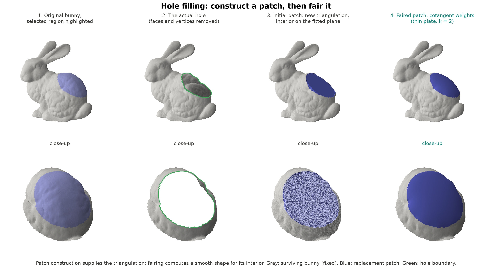

`docs/img/14-bunny-hole-filling-stages.png`. Top row: the whole bunny from the picture's angle (16, −62). Bottom row: close-ups at (32, −28), all with one frame. From left to right: the original with the selected region in light purple; the actual hole, with the loop in green (the inside of the bunny shows through); the initial patch, with its triangles drawn; and the cotangent thin plate. Gray is the fixed surviving surface, blue the replacement patch.

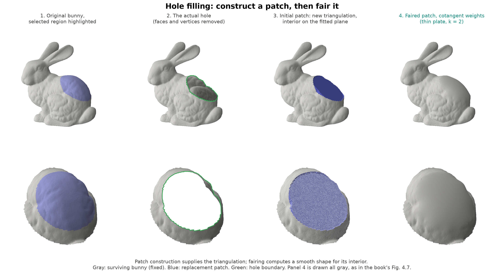

`docs/img/14-bunny-hole-filling-stages-gray.png` is the same figure, except that the faired bunny in panel 4 is drawn all gray, as in the book's Fig. 4.7 (right): there, the patch is not told apart from the rest of the surface.

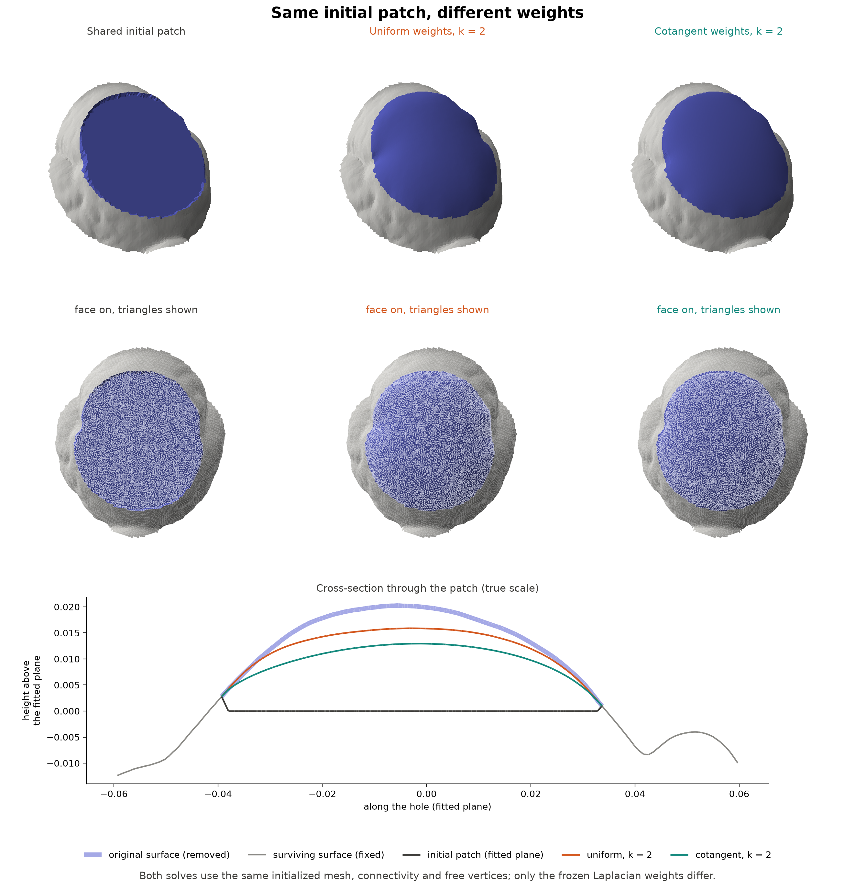

`docs/img/14-bunny-hole-filling-weights.png`. One column per mesh: the shared initial patch, the uniform thin plate (orange labels) and the cotangent one (teal labels). Row 1 shows close-ups at an angle; row 2 shows the same close-ups face on, with the triangles drawn. Row 3 is a cross-section at true scale, through the loop's centroid, along its longest direction and the fitted normal. It shows the original surface (thick, light purple), the surviving surface (gray), the planar start, and both thin plates: the uniform one stays closer to the original dome.

### A second real hole, on the upper rear of the back

`examples/05_bunny_hole_filling_rear.py` repeats the experiment above on a different hole, to see how the result changes. The method is the same, and the script reuses the functions of `examples/05_bunny_hole_filling.py` without changing them; only the region, the close-up camera and the figure are new.

**The region.** It was outlined by hand (a pink lens) on a picture of the bunny, head left: the upper rear of the back, up to the silhouette. As for the upper-back region, the outline was matched to the mesh once, outside the repository. The picture's silhouette matches the mesh's seen orthographically from (10, −61), with an IoU of 0.90. The faces visible inside the outline give 766 vertices. The ball that matches them best has its center near (0.0275, −0.0041, 0.1212) and a radius of 0.022; its region covers 97% of them, with an IoU of 0.93 on the visible vertices. `book_region` builds the region from that ball: 1063 vertices, a disk, at least 51 rings from the boundary edges. It lies entirely inside the first hole's region: it is that region's upper rear part, about a third of its size. A test checks that the region is a disk clear of the boundary, when the bunny is present.

**The hole and the patch.** Removing the region leaves 33771 vertices and 67186 triangles, and a loop of 141 vertices with mean edge h = 0.00118. This loop is much closer to planar than the first one: at most 0.0022 (1.8 h) from its fitted plane, 0.5 h on average. The patch has 1880 new interior vertices and 3899 triangles. The filled mesh has 35651 vertices and 71085 triangles, with the original Euler characteristic (−3). All the checks of the first hole pass again: the patch is rebuilt identically with the removed positions set to NaN; it reuses the loop's own vertices (the nearest new vertex is 0.60 h away); there are no gaps, seams or non-manifold edges; and the orientation is consistent. The smallest area is 0.34 of an equilateral triangle of side h. The smallest angle is 23.6°, much better than the first hole's 7.8°, because the loop rises less out of the plane. After fairing, the fixed vertices are bit-identical, and the relative residuals are 3.1 × 10⁻¹⁵ (uniform) and 3.2 × 10⁻¹⁵ (cotangent).

| patch (k = 2) | mean distance to the original | max distance (either way) | mean signed offset | mean \|H\| on the patch |
|---|---|---|---|---|
| (original removed region, for reference) | — | — | — | 39 |
| initial planar patch | 0.0030 (2.5 h) | 0.0060 | −0.0030 | — |
| uniform | 0.0007 (0.6 h) | 0.0019 | +0.0007 | 30 |
| cotangent | **0.0002** (0.1 h) | **0.0008** | −0.0000 | **24** |

The two faired patches differ by up to 0.0033 (2.8 edges).

What the second hole adds:
- **A smaller, flatter hole is filled almost exactly.** The cotangent thin plate lies on average 0.1 edge from the removed surface, and at most 0.7 edge. For the first hole, the mean distance was 2 edges. The thin plate replaces the region with the smoothest surface that fits its border, and the closer the original is to such a surface, the closer the patch comes to it.
- **The weights now rank the other way.** On the first hole, the uniform patch was closer to the original; here, the cotangent one is, by a factor of 3, and it no longer sinks below the original (offset −0.0000, against +0.0007 for the uniform patch). The comparison between the weights therefore depends on the hole, so neither weighting is better in general.

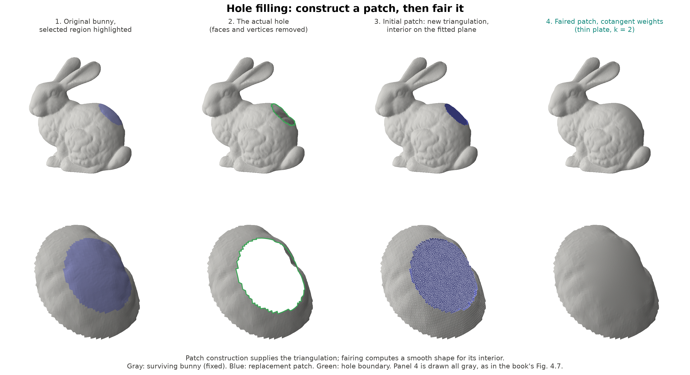

`docs/img/14-bunny-hole-filling-rear-stages-gray.png`, laid out like `14-bunny-hole-filling-stages-gray.png`. The top row uses the same camera as the first hole (16, −62), so the two figures can be compared. The bottom row shows close-ups from (40, −35), all with one frame. From left to right: the original with the region in light purple; the actual hole, with its loop in green; the initial patch, with its triangles drawn; and the cotangent thin plate, all gray, as in the book's Fig. 4.7.

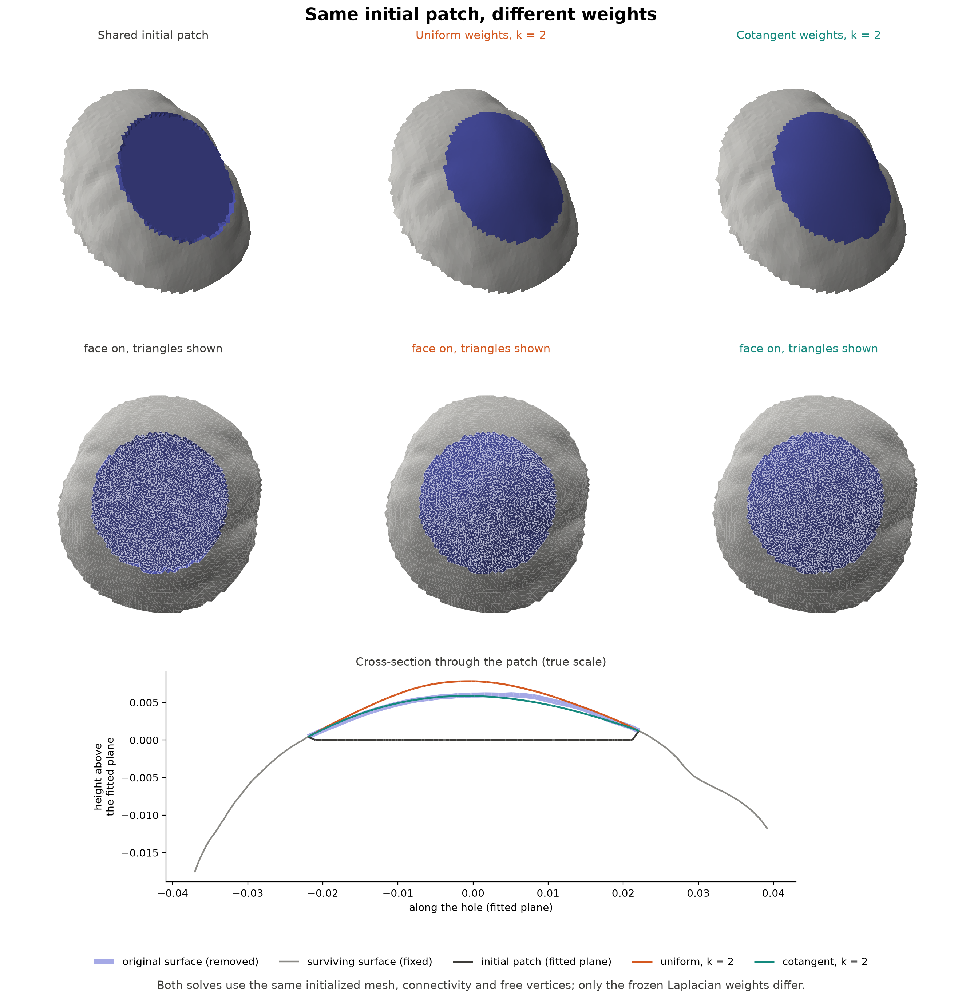

`docs/img/14-bunny-hole-filling-rear-weights.png`, laid out like `14-bunny-hole-filling-weights.png`: the shared initial patch, the uniform thin plate (orange labels) and the cotangent one (teal labels), at an angle and face on with the triangles drawn, and a cross-section at true scale. In the cross-section, the cotangent patch lies almost on the original surface, and the uniform patch bulges slightly above it. That is the opposite of the first hole, where both patches sank below the original and the uniform one stayed closer to it.

### The second hole, a little larger

`python examples/05_bunny_hole_filling_rear.py --larger` repeats the second hole with the same center and a larger ball: radius 0.028 instead of 0.022. The region grows from 1063 to 1715 vertices (a disk, at least 47 rings from the boundary edges), still inside the first hole's region, about half its size. Everything else is the same: the method, the checks and the figures.

**The hole and the patch.** The loop has 154 vertices with mean edge h = 0.00126, at most 0.0035 (2.8 h) from its fitted plane, 0.8 h on average. The patch has 2537 new interior vertices and 5226 triangles; the filled mesh has 35656 vertices and 71085 triangles, with the original Euler characteristic (−3). All the checks pass again: the rebuild with NaN positions is identical, the patch reuses the loop's own vertices (the nearest new vertex is 0.59 h away), there are no gaps, seams or non-manifold edges, and the orientation is consistent. The smallest area is 0.34 of an equilateral triangle of side h and the smallest angle 15.5°, between those of the two other holes, as is the loop's distance from its plane. After fairing, the fixed vertices are bit-identical, and the relative residuals are 3.8 × 10⁻¹⁵ (uniform) and 4.8 × 10⁻¹⁵ (cotangent).

| patch (k = 2) | mean distance to the original | max distance (either way) | mean signed offset | mean \|H\| on the patch |
|---|---|---|---|---|
| (original removed region, for reference) | — | — | — | 41 |
| initial planar patch | 0.0049 (3.9 h) | 0.0099 | −0.0049 | — |
| uniform | 0.0004 (0.3 h) | 0.0013 | +0.0002 | 31 |
| cotangent | **0.0003** (0.2 h) | **0.0011** | −0.0002 | **26** |

The two faired patches differ by up to 0.0038 (3.0 edges).

What the larger hole shows:
- **Both patches still match the original closely.** On average they lie 0.2–0.3 edge from the removed surface, and at most about one edge. The region is larger, but this part of the back is still close to the smooth surface that a thin plate produces.
- **The two weightings are now almost tied.** The cotangent patch is still slightly closer and smoother, and the uniform patch still bulges slightly above the original (+0.0002), but the gap between them is much smaller than for the outlined hole. Together with the first hole, where the uniform patch was closer, this shows again that the comparison depends on the hole.

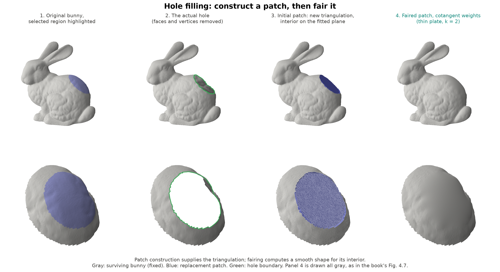

`docs/img/14-bunny-hole-filling-rear-large-stages-gray.png`, laid out like `14-bunny-hole-filling-rear-stages-gray.png`, with the same cameras. The close-ups crop a slightly larger area, to fit the larger hole.

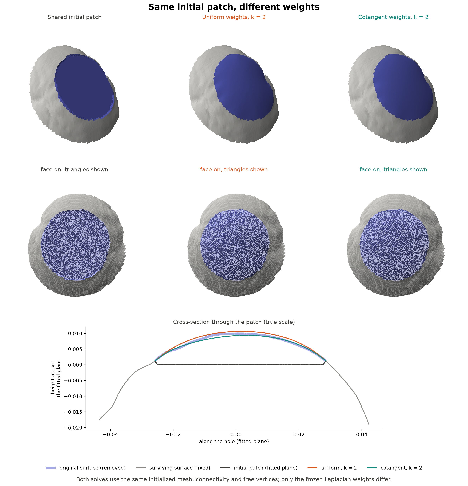

`docs/img/14-bunny-hole-filling-rear-large-weights.png`, laid out like `14-bunny-hole-filling-rear-weights.png`. In the cross-section, both patches follow the original surface; the uniform one is slightly above it and the cotangent one slightly below.

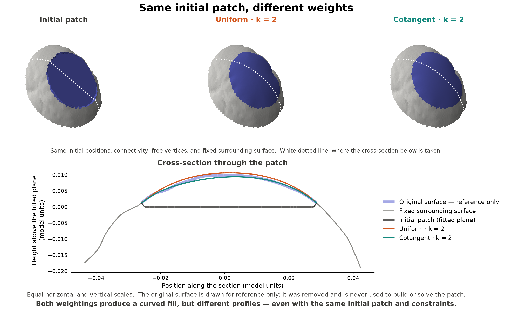

`docs/img/14-bunny-hole-filling-rear-large-weights-slide.png` is the same comparison, laid out for a landscape slide. The face-on wireframes are left out: the oblique views show the change of shape, and the cross-section shows how the two weightings differ. A white dotted line on each view marks where the section is taken. The section is enlarged and drawn with equal horizontal and vertical scales. Its coordinates are in the bunny file's own units, which the data does not document. The original surface is labeled "reference only": it was removed, and the patch is built and solved without it (the NaN rebuild checks this). The figure supports one conclusion: both weightings produce a curved fill, but with different profiles, from the same initial patch and constraints. It does not show that one weighting is better.

**Pitfalls.**
- *Check the mesh before trusting the operators.* Real data can be non-manifold, especially after decimation. Our `boundary_vertices` counts an edge as interior unless exactly one triangle uses it, so a non-manifold edge would silently pass. `edge_face_counts` makes the problem visible, and keeping k + 1 rings away from it makes it irrelevant for the solve.
- *The start matters for cotangent weights.* With the book's linear method, how the region is initialized decides the result when the weights are cotangent: a crude but clean patch (flattening) works far better than a noisy one. Uniform weights avoid the question, at the price of sampling artifacts on irregular meshes (#12); on this region they gave a smooth result.
- *File orientation.* The bunny files are y-up; the example rotates them to z-up for matplotlib's 3D axes.
- *A planar initialization only works for a hole that projects to a simple polygon.* This loop does, but a hole that wraps further around a curved part would fold over itself in the plane. `check_simple_polygon` refuses such a loop instead of producing overlapping triangles; it would need a different parametrization (Ch. 8).
- *The quality bound cannot hold next to a non-planar boundary.* Triangle guarantees 30° in the plane, but the loop's vertices return to their 3D positions, up to 4.5 edges off the plane, so the triangles that touch the loop are tilted and stretched (smallest angle 7.8°). Fairing does not move those boundary vertices; it only moves the interior.
- *Triangle's license.* The `triangle` package wraps Shewchuk's Triangle, which is free for research use but needs a license for commercial use, like the bunny itself. It is an optional extra, used only by this example and its test.
- *Matplotlib sorts by depth only within a collection.* `examples/05_bunny.py` and `examples/05_bunny_book_region.py` draw the fixed and the free faces as two `plot_trisurf` collections. Matplotlib sorts the triangles by depth inside each collection, but then draws whole collections one over the other. That works when the region faces the camera. On the upper back, though, the gray collection hid the blue region where it wraps over the back. `examples/05_bunny_back_region.py` therefore puts all faces in one `Poly3DCollection`, with per-face colors and the same shading as `plot_trisurf`.

## #15 Final documentation

**Theory → code.** No new equations or code in the library. The README now tells the story of the five phases in the book's order, and each step points to its note:
- one matrix, L = D·M (App. A.1), uniform (Eq. 3.10) or cotangent (Eq. 3.11), tested against Δx = −2H·n (Eq. 3.7): phase 2;
- smoothing as a flow, ∂x/∂t = λΔx (Eq. 4.5–4.6), explicit or implicit: phase 3;
- fairing, Lᵏx = 0 on the free vertices (§4.3), solved as the SPD system of Eq. A.2 with sparse Cholesky (§A.4), with C^(k−1) joints (Fig. 4.8), as the limit of the flow (p. 61), and for hole filling (Fig. 4.7): phases 4 and 5.

The README also has the install steps, a quick start, a table of the library's functions, a table of which script makes which figure, and a gallery of all 21 figures. `tests/test_docs.py` keeps it honest:

| Check | Test |
|---|---|
| every figure is written by an example script that the README lists, and shown in the README and in a phase note | `test_every_figure_is_made_by_a_listed_example_and_shown` |
| relative links and images in the README and the notes point to existing files | `test_relative_links_point_to_existing_files` |
| the README's quick-start code runs | `test_readme_quick_start_runs` |

**Reproducing the figures.** The six scripts were run from a clean clone of `main`, with the bunny copied from the existing download. All 21 PNGs came out byte-identical to the committed ones, in about 15 seconds. The README lists the library versions used.

**Review of the notes.** Every equation number was checked against the book, and every code citation against the line it points to, including the 20 (of 52) that `test_docs.py` does not check: line ranges (`smoothing.py:58–60`<!-- spla.eigsh( -->) and citations without a function name (`laplacian.py:37`<!-- W = adjacency(F, n) -->). All pointed to the intended statements. The fixes were about wording and stale references:
- *Cholesky notation.* §A.4 writes A = LLᵀ, where L is the triangular factor, not the Laplace matrix. Phase 4 now says so; the code comment uses RᵀR.
- *What the book says, and what we derived.* The book says only that implicit integration should be used for large time steps (§4.2). "Unconditionally stable for any h" is our derivation in #8, and the notes and README now say so. Likewise, Fig. 4.8's caption says that k sets the *maximum* smoothness C^(k−1), and p. 60–61 states the flow claims for the kth-order flow ∂x/∂t = Δᵏx, which #13 tests for k = 1.
- *A gap filled.* §A.6 (Table A.1) compares SuperLU, the LU behind SciPy's `factorized`, with a sparse Cholesky solver. Phase 4's "Solver choice" now cites it.
- *Stale forward references,* written before later issues existed (for example, "the bunny (#14) must be checked"), now point to what was actually done. The moonshot M1 (#16) is described as optional and not implemented.

**What the figures show.** No new figure: the README gallery shows the 21 existing ones, each with one sentence and the issue whose note explains it.

**Pitfalls.**
- *A citation test only checks what it can parse.* `test_docs.py` checks citations of the form `function`, `file.py:N`, and only that N lies inside the function. A line inside the right function but on the wrong statement passes, and citations without a function name are skipped. #33 (below) closes this gap.
- *Write what the book says, not what we proved.* Several sentences sounded like quotes of the book but were our own results. Checking each claim against the book's wording found them.

## #33 Stricter citation test (follow-up to #15)

**Theory → code.** No book equation. The "Theory → code" tables are only useful if each line number points at the statement that implements the equation. The old test checked a proxy, "line N lies inside the cited function", which stays true when lines shift *within* the function. That is the most common way line numbers go stale. The new test checks the property itself. Each citation names its statement in a hidden HTML comment right after it, which GitHub does not render:

  `` `fairing/fairing.py:33`<!-- A = A @ D @ M --> ``

| Rule | Test |
|---|---|
| the named statement is on the cited line, or in the cited range `N–M`; otherwise the message gives the line it is on now | `test_cited_lines_contain_their_statement` |
| a citation without a statement fails, unless it cites a function's own `def` line right after the function's backticked name | `test_cited_lines_contain_their_statement` |
| the short form `:N` refers to the file cited just before it on the same line | `line_citations`, `tests/test_docs.py` |
| the notes contain at least 40 line citations, so a broken pattern cannot silently check nothing | `test_notes_contain_line_citations` |

All 54 citations that the notes had before this issue are now checked: 23 cite a `def` line, and 31 name their statement, including the 20 that the old test skipped. The two examples in this section are checked too. The old check, that a cited line lies inside its function, stays as a second test.

**When the test fails.** If code moves, the message says, for example, `` `rhs = -(A_fc @ V[~free])` is not there; it is now on line 72 ``. Update the line number in the note; the statement stays the same. To check the test, we inserted one line at the start of `solve_fair`'s body. The new test flagged all five citations below it with their new lines, while the old function-span test still passed.

**What the figures show.** No figure.

**Pitfalls.**
- *A comment line is not a statement.* The phase-2 citation of line 82 of `laplacian.py` pointed at the comment "duplicate (i, j) entries are summed". The summing happens in the next statement, the conversion from COO to CSR. The citation now covers lines 82–84 and names `sp.coo_matrix(`.
- *A range pins only one statement.* `smoothing.py:58–60`<!-- spla.eigsh( --> names the `eigsh` call in phase 3's text and the `return` line in its table. If lines are inserted inside the range, the named statement may still be within it, so keep ranges short.
- *Even examples are checked.* While this section was being written, the test flagged two citations in it that named no statement. A line number that is only mentioned, not cited, is written without backticks.
- *The comment must survive Markdown.* A statement containing `|` would split a table cell, and `-->` would end the comment early. None of ours does; pick another part of the line if one ever does.
